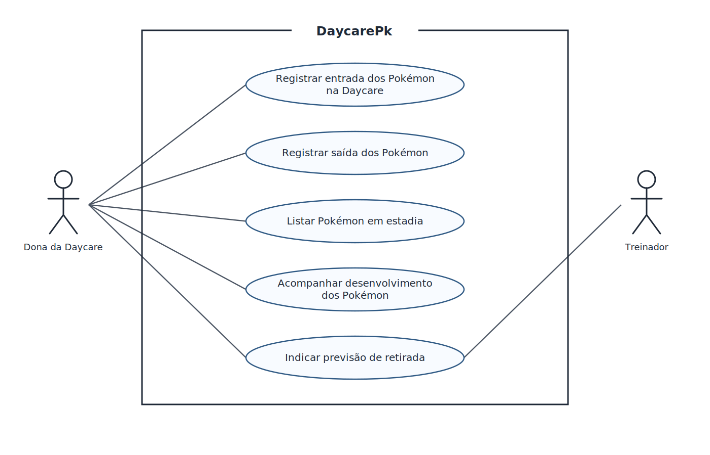

# 4.2.2 Modelagem de Casos de Uso

## Atores

| Ator | Quem é | O que faz no sistema |
|---|---|---|
| Dona da Daycare | Responsável pela operação e pelo cuidado dos Pokémon durante a estadia. | Registra entradas e saídas, consulta a lista de Pokémon em estadia e registra o desenvolvimento e os cuidados realizados. |
| Treinador | Responsável pelo Pokémon recebido pela Daycare. | Consulta a previsão de retirada do Pokémon sob sua responsabilidade. |

## Casos de uso

| Caso de uso | Ator | Atende |
|---|---|---|
| Registrar entrada dos Pokémon na Daycare | Dona da Daycare | RF01 |
| Registrar saída dos Pokémon | Dona da Daycare | RF02 |
| Listar Pokémon em estadia | Dona da Daycare | RF03 |
| Acompanhar desenvolvimento dos Pokémon | Dona da Daycare | RF04 |
| Indicar previsão de retirada | Dona da Daycare, Treinador | RF06 |

## Diagrama de casos de uso

**Figura 1 – Diagrama de casos de uso do DaycarePk**

Fonte: Autoria própria (2026).

A Dona da Daycare e o Treinador aparecem fora da fronteira do DaycarePk, enquanto os cinco casos de uso ficam dentro dela. A Dona da Daycare participa dos registros e das consultas operacionais; ambos os atores consultam a previsão de retirada. Não há relações «include» ou «extend», pois os casos apresentados não compartilham um passo obrigatório nem representam comportamentos opcionais independentes.

## Especificação do caso de uso principal

O caso de uso principal é **Acompanhar desenvolvimento dos Pokémon**, pois representa o acompanhamento do cuidado e do progresso durante a estadia, objetivo central do DaycarePk.

| Campo | |
|---|---|
| Caso de uso | Acompanhar desenvolvimento dos Pokémon |
| Ator | Dona da Daycare |
| Pré-condição | A Dona da Daycare está autorizada a acessar o sistema e o Pokémon possui uma estadia ativa. |
| Pós-condição | O progresso e os cuidados informados ficam associados à estadia do Pokémon e disponíveis em seu histórico. |

**Fluxo principal**

1. A Dona da Daycare informa qual Pokémon está sendo acompanhado.
2. O sistema verifica se o Pokémon possui uma estadia ativa.
3. O sistema apresenta os dados da estadia para identificação.
4. A Dona da Daycare informa o progresso observado e os cuidados realizados.
5. O sistema registra a data e as informações do desenvolvimento na estadia.
6. O sistema confirma o registro e atualiza o histórico do Pokémon.

**Fluxo alternativo**

- **A1, no passo 4: não há evolução a registrar.** A Dona da Daycare informa o progresso e os cuidados sem preencher uma evolução; o sistema prossegue para o passo 5.

**Fluxos de exceção**

- **E1, no passo 2: o Pokémon não possui estadia ativa.** O sistema informa que não é possível registrar o desenvolvimento para uma estadia encerrada ou inexistente, e o caso termina sem a pós-condição.
- **E2, no passo 5: não é possível salvar o registro.** O sistema informa que o desenvolvimento não foi registrado, e o caso termina sem a pós-condição.

## Rastreabilidade com a 4.2.1

| Requisito | Caso de uso | Onde aparece |
|---|---|---|
| RF01 Registrar entrada dos Pokémon na Daycare | Registrar entrada dos Pokémon na Daycare | No caso de uso correspondente e no fluxo principal da entrada, em que a estadia e seus dados são registrados. |
| RF02 Registrar saída dos Pokémon | Registrar saída dos Pokémon | No caso de uso correspondente e no fluxo de encerramento da estadia, que registra a data de saída e confirma a devolução. |
| RF03 Listar Pokémon em estadia | Listar Pokémon em estadia | No caso de uso correspondente, que apresenta os Pokémon com estadia ativa para acompanhamento. |
| RF04 Acompanhar desenvolvimento dos Pokémon | Acompanhar desenvolvimento dos Pokémon | No caso de uso especificado, principalmente nos passos 4 a 6 do fluxo principal. |
| RF05 Manter histórico de permanência | Nenhum caso de uso próprio | Como resultado dos registros de entrada, saída e desenvolvimento; na especificação, aparece no passo 6 do fluxo principal de acompanhamento. |
| RF06 Indicar previsão de retirada | Indicar previsão de retirada | No caso de uso correspondente, disponível à Dona da Daycare e ao Treinador para organizar a devolução. |

Todos os requisitos funcionais têm um caso de uso ou um ponto explícito nos fluxos. Cada elipse atende ao requisito indicado na tabela de casos de uso; RF05 não tem elipse própria porque o histórico é mantido como parte dos registros de outros casos. A especificação detalha as condições para acompanhar o desenvolvimento, incluindo a estadia ativa, o registro de progresso e os caminhos alternativo e de exceção.
