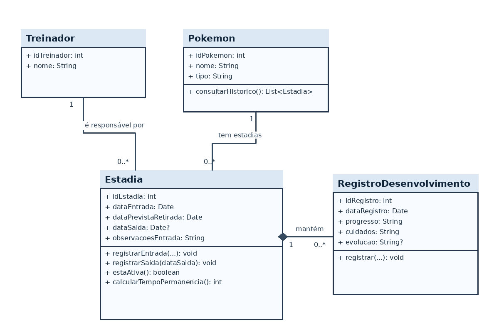
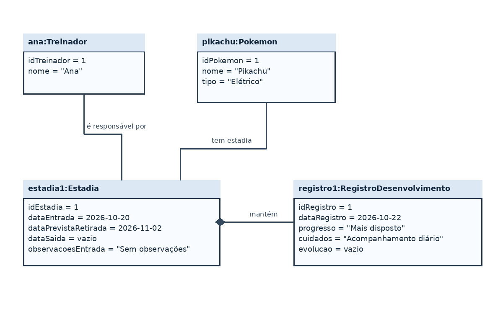

# 4.2.3 Modelagem de Classes

## Dos substantivos às classes

A 4.2.2 ainda está no molde, sem fluxo principal especificado. Por isso, as candidatas abaixo vêm dos requisitos funcionais e das histórias de usuário da 4.2.1, além do escopo da 4.1. Quando o fluxo principal for escrito, esta análise deverá ser conferida com os substantivos e as ações que ele trouxer.

| Substantivo | De onde veio | Vira | Por quê |
|---|---|---|---|
| Pokémon | Histórias 1 a 5; RF01, RF03, RF04 e RF05 | classe `Pokemon` | É o elemento acompanhado e reúne as estadias e registros de desenvolvimento. |
| treinador | Histórias 4 e 5; RF01; 4.1, “Quem usa” | classe `Treinador` | O sistema precisa associar o treinador ao Pokémon recebido e à sua estadia. |
| dona da Daycare | Histórias 1 a 3; RF01, RF02 e RF04 | ator, não classe | Ela opera os registros; os requisitos não definem dados próprios para uma classe de funcionária ou usuária. |
| entrada, saída e permanência | Histórias 1 e 3; RF01, RF02 e RF05 | classe `Estadia` | Cada permanência tem suas próprias datas e pode ser consultada no histórico. |
| previsão de retirada | História 5; RF06 | atributo de `Estadia` | É uma data referente à permanência do Pokémon; nesta versão, é informada pela dona. |
| observações de entrada | História 1; RF01 | atributo de `Estadia` | São informações registradas quando o Pokémon chega. |
| desenvolvimento, progresso, evolução e cuidados | História 2; RF04 e RF05 | classe `RegistroDesenvolvimento` | São registros que podem ocorrer ao longo da estadia e integrar o histórico. |
| lista de Pokémon em estadia | RF03 | consulta das `Estadia` ativas | É o resultado de consultar estadias sem data de saída, não um dado independente. |
| tela, botão e relatório | RNF de usabilidade e consultas da 4.1 | nada | São elementos de interface ou apresentação, não informações do domínio a guardar. |
| Daycare | 4.1, contexto do sistema | nada | É o contexto do projeto; os requisitos não pedem cadastro dos dados do estabelecimento. |

`dataSaida` e `dataPrevistaRetirada` são atributos de `Estadia`, não classes: são datas de uma permanência específica. A data de saída fica vazia enquanto a estadia estiver aberta. A previsão é informada pela dona da Daycare, pois os requisitos não definem uma regra de cálculo.

## Classes

O modelo tem quatro classes. Cada atributo e operação está relacionado à sua origem na última coluna. Os identificadores permitem distinguir registros ao associá-los no histórico; serão confirmados quando o fluxo e o modelo de dados forem detalhados.

| Classe | Atributos | Operações | Veio de |
|---|---|---|---|
| **`Treinador`** | `idTreinador: int` `nome: String` | Nenhuma própria | `idTreinador`: RF01 e RF05, para distinguir e referenciar o treinador ligado aos registros. `nome`: RF01, que exige registrar o treinador associado à entrada; o requisito não detalha outros dados pessoais. |
| **`Pokemon`** | `idPokemon: int` `nome: String` `tipo: String` | `consultarHistorico(): List<Estadia>` | `idPokemon`: RF05, para distinguir o Pokémon no histórico. `nome` e `tipo`: RF01. `consultarHistorico`: RF05. |
| **`Estadia`** | `idEstadia: int` `dataEntrada: Date` `dataPrevistaRetirada: Date` `dataSaida: Date?` `observacoesEntrada: String` | `registrarEntrada(dataEntrada: Date, dataPrevistaRetirada: Date, observacoes: String): void` `registrarSaida(dataSaida: Date): void` `estaAtiva(): boolean` `calcularTempoPermanencia(): int` | `idEstadia`: RF05, para distinguir cada período no histórico. `dataEntrada` e `observacoesEntrada`: RF01. `dataPrevistaRetirada`: RF06. `dataSaida`: RF02. `registrarEntrada`: RF01. `registrarSaida`: RF02. `estaAtiva`: RF03. `calcularTempoPermanencia`: objetivo da 4.1 de acompanhar o tempo de permanência. |
| **`RegistroDesenvolvimento`** | `idRegistro: int` `dataRegistro: Date` `progresso: String` `cuidados: String` `evolucao: String?` | `registrar(progresso: String, cuidados: String, evolucao: String?): void` | `idRegistro`: RF05, para distinguir registros no histórico. `dataRegistro`: RF04 e RF05, para situar o acompanhamento no tempo. `progresso`, `cuidados` e `evolucao`: RF04. `registrar`: RF04. |

`Date?` indica que o campo pode ficar vazio. A estadia está ativa quando `dataSaida` não foi informada; por isso o modelo não duplica essa informação em um atributo `status`. `evolucao` é opcional para os registros em que não houver evolução.

## Diagrama de classes

**Figura 2 – Diagrama de classes do DaycarePk**

Fonte: Autoria própria (2026).

As linhas contínuas representam associações. Um `Treinador` é responsável por zero ou várias `Estadia`; cada estadia se refere a exatamente um treinador. Um `Pokemon` tem zero ou várias estadias; cada estadia pertence a exatamente um Pokémon. Os números ficam junto da classe que contam.

O losango cheio junto de `Estadia` indica composição: uma estadia mantém zero ou vários `RegistroDesenvolvimento`, e cada registro pertence a exatamente uma estadia. A regra definida para este modelo é que, se uma estadia for excluída, seus registros de desenvolvimento também serão excluídos. Não há herança porque os requisitos não definem especializações de classe, nem agregação porque não foi definida uma relação parte-todo em que a parte sobreviva à exclusão do todo.

## Teste de objetos

Considere este exemplo de atendimento: Ana deixou seu Pikachu na Daycare em 20 de outubro de 2026; a previsão de retirada informada foi 2 de novembro, e a dona registrou o progresso e os cuidados em 22 de outubro.

**Figura 3 – Diagrama de objetos de uma estadia do DaycarePk**

Fonte: Autoria própria (2026).

| Objeto | Classe | Valores |
|---|---|---|
| `ana` | `Treinador` | `idTreinador = 1`, `nome = "Ana"` |
| `pikachu` | `Pokemon` | `idPokemon = 1`, `nome = "Pikachu"`, `tipo = "Elétrico"` |
| `estadia1` | `Estadia` | `idEstadia = 1`, `dataEntrada = 2026-10-20`, `dataPrevistaRetirada = 2026-11-02`, `dataSaida = vazio`, `observacoesEntrada = "Sem observações"` |
| `registro1` | `RegistroDesenvolvimento` | `idRegistro = 1`, `dataRegistro = 2026-10-22`, `progresso = "Mais disposto"`, `cuidados = "Acompanhamento diário"`, `evolucao = vazio` |

**Ligações:** `ana` e `estadia1`, `pikachu` e `estadia1`, `estadia1` e `registro1`.

**O que o teste confirma**

- **Cada estadia se refere a um treinador e a um Pokémon.** `estadia1` está ligada a exatamente um objeto de cada classe.
- **Uma estadia pode ter registros de desenvolvimento.** `registro1` pertence à estadia em que o progresso foi observado.
- **A estadia está ativa enquanto não tem data de saída.** O campo `dataSaida` vazio corresponde ao resultado verdadeiro de `estaAtiva()`.
- **O registro depende da estadia.** Pela composição definida, excluir `estadia1` também exclui `registro1`.

O exemplo cabe nas multiplicidades do diagrama e ilustra as relações e o ciclo de vida definidos. Uma situação com várias estadias ou vários registros deverá ser conferida novamente quando o fluxo principal for especificado.

## Rastreabilidade com a 4.2.2

A 4.2.2 ainda não contém atores, casos de uso ou fluxo principal. A coluna de origem abaixo aponta para os RFs e a 4.1 que sustentam os elementos; a correspondência a casos de uso e passos específicos será completada quando a 4.2.2 for preenchida.

| Operação ou atributo | Classe | De onde veio |
|---|---|---|
| `idTreinador` | `Treinador` | RF01 e RF05: distinguir e referenciar o treinador associado aos registros. |
| `nome` | `Treinador` | RF01: registrar o treinador associado à entrada; o formato exato de identificação ainda precisa ser confirmado. |
| `idPokemon` | `Pokemon` | RF05: distinguir o Pokémon no histórico. |
| `nome`, `tipo` | `Pokemon` | RF01: informações registradas na entrada. |
| `consultarHistorico()` | `Pokemon` | RF05: manter o histórico de permanência do Pokémon. |
| `idEstadia` | `Estadia` | RF05: distinguir os períodos que compõem o histórico. |
| `dataEntrada`, `observacoesEntrada` | `Estadia` | RF01: registrar a entrada com observações. |
| `dataPrevistaRetirada` | `Estadia` | RF06: indicar a previsão de retirada, informada pela dona. |
| `dataSaida` | `Estadia` | RF02: registrar a saída do Pokémon. |
| `registrarEntrada()` | `Estadia` | RF01: registrar a entrada na Daycare. |
| `registrarSaida()` | `Estadia` | RF02: registrar a saída e a devolução ao treinador. |
| `estaAtiva()` | `Estadia` | RF03: selecionar os Pokémon que ainda estão em estadia. |
| `calcularTempoPermanencia()` | `Estadia` | Objetivo da 4.1: acompanhar o tempo de permanência. |
| `idRegistro` | `RegistroDesenvolvimento` | RF05: distinguir registros no histórico. |
| `dataRegistro` | `RegistroDesenvolvimento` | RF04 e RF05: situar os registros de desenvolvimento no histórico. |
| `progresso`, `cuidados`, `evolucao` | `RegistroDesenvolvimento` | RF04: acompanhar progresso, evolução e cuidados realizados. |
| `registrar()` | `RegistroDesenvolvimento` | RF04: registrar o desenvolvimento do Pokémon. |

**Toda operação tem origem?** Sim: as operações estão ligadas a RFs ou ao objetivo da 4.1. A associação dos registros de desenvolvimento a uma estadia e a regra de composição são decisões do modelo que deverão ser confrontadas com o fluxo e validadas com a cliente.

**Todo passo do sistema tem casa?** Ainda não é possível verificar: a 4.2.2 não tem fluxo principal. Quando ele existir, cada passo executado pelo sistema deverá ser associado a uma operação ou classe.

**O que a modelagem mudou?** A 4.2.2 ainda não especificou substantivos nem ações; por isso, nenhuma mudança vinda do fluxo foi aplicada. Esta versão deriva as classes dos RFs e das histórias de usuário e deverá ser revisada quando a especificação estiver pronta.
